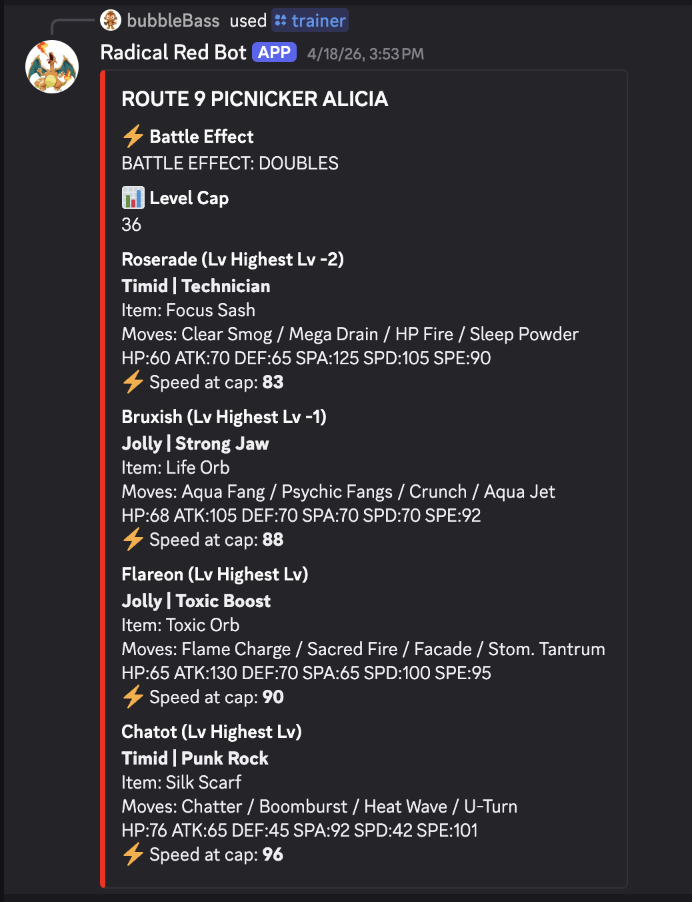
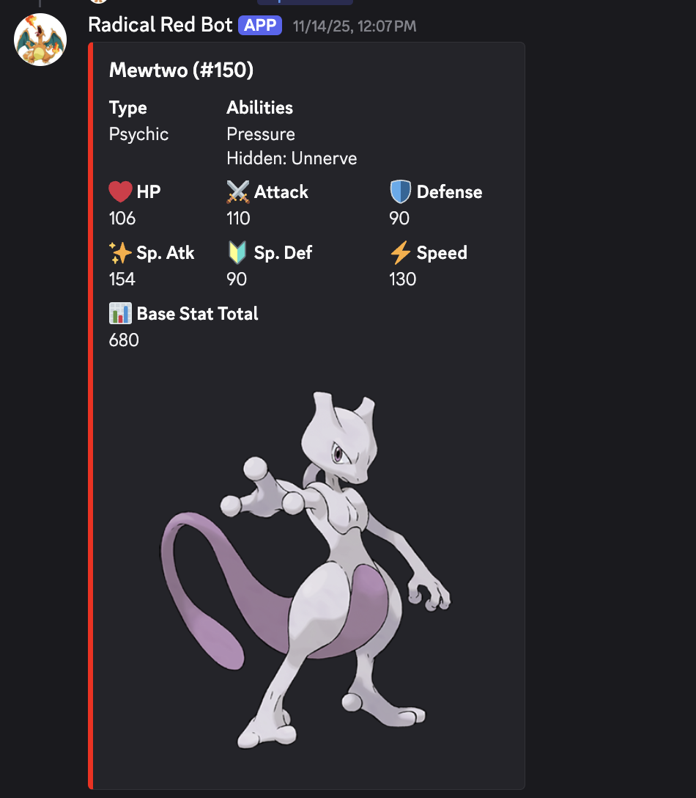

# Radical Red Bot

A public Discord lookup bot for Pokemon Radical Red trainer data, hosted 24/7 on AWS EC2. The bot lets players quickly look up trainer teams, route encounters, battle effects, level caps, stats, items, abilities, and moves from Discord.

## Screenshots

### Trainer Encounter Lookup



### Pokemon Stat Lookup



## What It Does

- Search trainers by name with `/trainer`.
- Search routes or locations with `/route`.
- Disambiguate multiple matching trainers or encounters through Discord select menus.
- Show teams with Pokemon level, nature, ability, item, moves, stats, level cap, battle effect, starter variant, and speed at level cap when available.
- Search Pokemon stat data through the API-backed bot data.

## Project Layout

```text
api/main.py              FastAPI app and HTTP lookup endpoints
bot/main.py              Discord bot, slash commands, and embed builders
cache/redis.py           Redis cache helpers
db/base.py               SQLAlchemy declarative base
db/models.py             Pokemon, trainer, encounter, team, and move models
db/session.py            Database engine/session setup
scripts/init_db.py       Creates database tables
scripts/parse_sheet.py   Fetches and parses Google Sheet tabs into JSON
scripts/seed_db.py       Seeds parsed encounter JSON into the database
data/parsed_encounters.json
                         Parsed trainer encounter dataset used by seed script
requirements.txt         Python dependencies
```

## Discord Commands

### `/trainer`

Looks up a trainer by trainer name or location text.

Examples:

```text
/trainer name:Brock
/trainer name:Route 22
```

If multiple trainers or encounters match, the bot shows a select menu.

### `/route`

Looks up all trainer encounters matching a route or location.

Example:

```text
/route location:Route 22
```

## API Endpoints

### `GET /trainer?name=...`

Searches trainers by partial name.

Returns trainer IDs, names, classes, and encounter counts.

### `GET /trainer/{trainer_id}/encounters`

Returns all encounters for one trainer.

### `GET /encounter/{encounter_id}`

Returns full encounter details, including the team and each Pokemon's moves and stats.

### `GET /location?name=...`

Searches encounters by partial location text.

### `GET /pokemon/{name}`

Searches Pokemon by partial name and returns base stats stored in the database.

## Refreshing Parsed Data

The parser in `scripts/parse_sheet.py` fetches CSV exports from the configured Google Sheet tabs and writes:

```text
data/parsed_encounters.json
```

Run it with:

```bash
python scripts/parse_sheet.py
```

Then reseed the database:

```bash
python scripts/seed_db.py
```

The parser currently keeps the full trainer/location label as `trainer_name` and `location`, which matches how the API and bot search today.

## Data Notes

- `data/parsed_encounters.json` is the main structured dataset used by the seed script.
- `data/trainers.json`, `data/rivals.csv`, and `data/rivals_sample.csv` are auxiliary/source data files.
- `data/main.csv` currently appears to contain an HTML error response from Google rather than usable CSV trainer data.

## Development Notes

- API responses are cached for one hour by default.
- Cache keys are based on endpoint and query values.
- If Redis is unavailable, API requests that use cache helpers will fail.
- There are no automated tests in the repository yet.
- Generated Python bytecode directories are present in the working tree, but they are not required to run the project.
